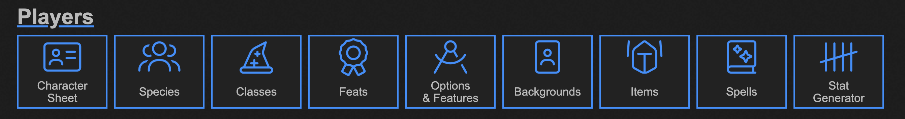
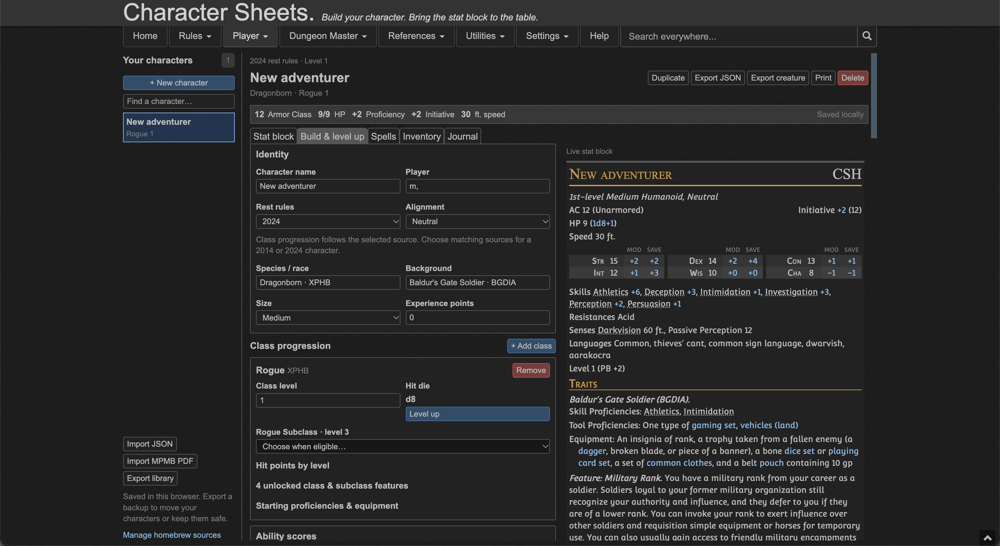
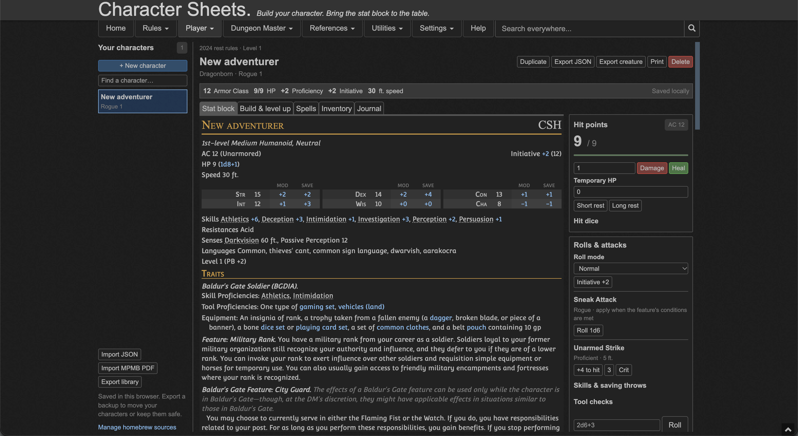

# 5etools — Character Sheets

A fork of [5etools](https://github.com/5etools-mirror-3/5etools-src) with editable character sheets that render as bestiary stat blocks. Build and level characters using the local 5etools data, manage them during play, and import existing MPMB PDF sheets.

The character tab uses the site's light/night themes, compact controls, navigation, and bestiary renderer. The fork's `main` branch includes Character Sheets and builds on **5etools v2.40.1**.

## Run locally

Install **Node.js 24 or newer**, then:

```sh
git clone --branch main https://github.com/8AE/5etools-character-sheets.git
cd 5etools-character-sheets
npm ci
npm run serve:dev
```

Open [Character Sheets](http://127.0.0.1:5050/characters.html), or choose **Player → Character Sheets** from the site's navigation. Use the local server for development and testing. Opening the HTML directly with a `file://` URL will not load the modules and data correctly.

The generated character page, CSS, and PDF-reader libraries are included. A full site build is not needed to get started. As in the upstream source repository, the separately distributed `img/` artwork directory is not included.

## Screenshots

Open **Character Sheet** from the **Players** row on the homepage.



In **Build & level up**, edit the character and see the live stat block alongside the class choices.



During play, use **Stat block** to track hit points, take a rest, or roll an attack.



## Character-sheet features

- **Build from the library:** classes, subclasses, species, backgrounds, feats, spells, and equipment from this clone's data and installed homebrew, with 2014 and 2024 content.
- **Level up:** multiclassing, subclass unlocks, ability improvements, feats, and class feature choices. Level-specific selections are retained when reducing a class level.
- **Make custom choices:** type campaign-specific languages, tools, feats, and optional features into the corresponding choice slots. Custom definitions travel with the character's JSON.
- **Play from a stat block:** bestiary presentation plus HP, temporary HP, death saves, attacks, saves, skills, tool checks, spell slots, hit dice, limited resources, rests, and a roll log.
- **Manage equipment and spells:** quantities, equipped/attuned state, starting equipment, spell preparation, casting resources, and structured spell scaling.
- **Keep multiple characters:** a browser-local roster, individual or whole-library JSON import/export, and creature snapshots for the Homebrew Manager.

See the [character-sheet guide](doc/character-sheets.md) for the full workflow and supported automation.

## Import an MPMB PDF

1. Choose **Import MPMB PDF** and select a saved, fillable MorePurpleMoreBetter character sheet.
2. Review the detected character, library matches, and unmatched details. Select 2014 or 2024 source matching as appropriate.
3. Choose **Import character** to add a new sheet. Existing characters remain unchanged.

The importer reads saved character fields, including class levels, subclasses, scores, proficiencies, feats, inventory, spells, resources, and notes. Matching entries use the local 5etools rules. Unmatched feats become custom feats; unmatched equipment stays editable in inventory. Other unresolved details are retained in Journal for review.

Final ability scores and prior increases are preserved without applying them twice. New level-ups use normal progression. Unmatched weapons retain manual attack values; edit them or match them to a library item to use automatic calculations.

PDF processing happens on the user's device. Embedded PDF JavaScript and MPMB scripts are never executed. Uploads must be unencrypted, fillable AcroForm PDFs up to 50 MiB; scans, flattened PDFs, and XFA forms are unsupported. Keep the original PDF and review the import notes, especially for custom rules or scripts.

## Saves and portability

Characters are stored in the browser's local storage under `5etools.characters.v1`. Different hostnames, ports, and browser profiles have separate libraries. Export a backup before clearing browser data or switching servers.

**Export JSON** and **Export library** preserve editable character state, custom choices, and imported item details. **Export creature** produces a bestiary snapshot, not an editable character backup. The format is documented in [the guide](doc/character-sheets.md#storage-and-portable-json) and [JSON schema](schema/characters.schema.json).

## Automation limits

The sheet calculates structured rules and common feature effects. It does not adjudicate combat or automate every rule described in prose. Situational bonuses, exceptional subclass effects, custom feat mechanics, and other campaign rulings may require manual adjustments or resource trackers. MPMB import transfers saved state rather than reproducing the PDF's entire scripting engine or reconstructing every past level-up choice.

## Development and tests

Run all unit tests:

```sh
npm run test:unit -- --runInBand
```

Run only the character-sheet and MPMB import tests:

```sh
npm run test:unit -- --runInBand --runTestsByPath test/jest/CharacterSheet.test.js test/jest/MpmbImport.test.js
```

The tests use local 5etools data and synthetic PDF fixtures. They cover progression, calculations, custom choices, casting, import validation, JSON round trips, and PDF import confirmation/cancellation. Browser interaction and layout checks are a separate step; see the [regression checklist](doc/character-sheets.md#implementation-and-checks).

After changing templates, styles, or the pinned PDF dependencies, regenerate the relevant outputs:

```sh
npm run gen:pages
npx sass --style=compressed scss/characters.scss css/characters.css
node node/generate-character-pdf-libs.js
```

Character logic lives in `js/characters/`, with the page controller in `js/characters.js`. The page template is in `node/generate-pages/template/page/template-page-characters.hbs` and its styles are in `scss/characters.scss`.

## Upstream and contributions

Original project: [5etools source](https://github.com/5etools-mirror-3/5etools-src), by TheGiddyLimit and contributors. This is an independent character-sheet fork. Report issues with these additions in [this fork's issue tracker](https://github.com/8AE/5etools-character-sheets/issues). General upstream contribution guidance remains in [CONTRIBUTING.md](CONTRIBUTING.md).

## License and bundled libraries

The project retains the upstream [MIT license](LICENSE.md) and attribution. PDF import uses locally bundled [pdf-lib and JSON5](lib/character-pdf-libs.md); their license files are included in `lib/`. No personal character PDF or extracted player data is included in the application or test fixtures.
